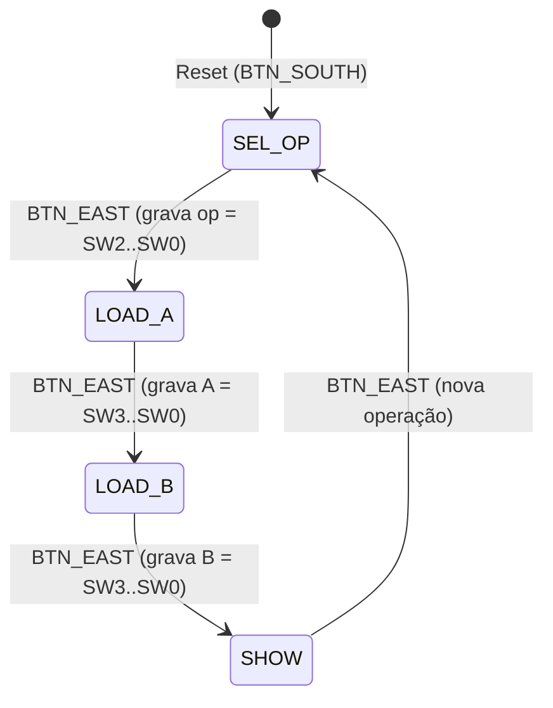

# ULA de 4 Bits em VHDL — Trabalho Prático 1

Projeto desenvolvido para a disciplina de **Sistemas Digitais** da **Universidade Federal do Rio de Janeiro (UFRJ)**.

Este repositório contém a implementação completa em **VHDL** de uma **Unidade Lógica e Aritmética (ULA) de 4 bits**, integrada a uma Máquina de Estados Finitos (FSM) e filtro digital de *debounce*, projetada para síntese no kit FPGA **Xilinx Spartan-3A Starter Kit (UG334)** utilizando o **Xilinx ISE**.

---

## Sumário

- [Visão Geral](#visão-geral)
- [Estrutura do Repositório](#estrutura-do-repositório)
- [Arquitetura do Sistema](#arquitetura-do-sistema)
- [Operações Suportadas](#operações-suportadas)
- [Flags de Status](#flags-de-status)
- [Modo de Uso na Placa](#modo-de-uso-na-placa)
- [Mapeamento de Pinos (`Pinos.ucf`)](#mapeamento-de-pinos-pinosucf)
- [Síntese e Gravação (Xilinx ISE)](#síntese-e-gravação-xilinx-ise)
- [Simulação](#simulação)

---

## Visão Geral

Como o kit **Spartan-3A Starter Kit** dispõe de 4 chaves deslizantes (`SW3..SW0`) e 8 LEDs discretos (`LED7..LED0`), o projeto utiliza uma interface sequencial controlada por um único botão de avanço (`BTN_EAST`) e um botão de *reset* (`BTN_SOUTH`):

1. O usuário seleciona a **operação** nas chaves e confirma no botão.
2. Insere o **operando `A`** (4 bits) e confirma.
3. Insere o **operando `B`** (4 bits) e confirma.
4. Visualiza nos 8 LEDs o **resultado de 4 bits** junto com as **4 *flags* de status (`Z`, `N`, `C`, `V`)**.

Todo o circuito opera de forma totalmente síncrona sob um único domínio de clock de **50 MHz**, sem utilizar botões diretamente como sinal de clock.

---

## Estrutura do Repositório

| Arquivo | Descrição |
| :--- | :--- |
| `ULA.vhd` | Código-fonte VHDL contendo os três módulos do sistema: `debounce`, `alu4` e a entidade *top-level* `ula_top`. |
| `Pinos.ucf` | Arquivo de restrições (*User Constraints File*) com pinagem, padrões de I/O (`LVCMOS33`) e restrições de *timing* (clock de 50 MHz / 20 ns) para a placa Spartan-3A Starter Kit. |
| `README.md` | Documentação do projeto. |

---

## Arquitetura do Sistema

O arquivo `ULA.vhd` é organizado em três entidades modulares:

### 1. `debounce` (Filtro de Ruído Mecânico)
- **Sincronização:** Utiliza 2 *flip-flops* em cascata (`sync`) para mitigar metaestabilidade na leitura assíncrona do botão.
- **Temporização:** Exige que o nível lógico permaneça estável por `DEBOUNCE_MS` (padrão: **10 ms** a **50 MHz**, equivalente a 500.000 ciclos) antes de validar a transição.
- **Detecção de borda:** Gera na saída `pulso` um pulso limpo de exatamente **1 ciclo de clock** a cada pressionamento do botão.

### 2. `alu4` (Núcleo Combinacional da ULA)
- Circuito puramente combinacional (sem inferência de *latches*).
- **Somador único compartilhado:** As quatro operações aritméticas (`ADD`, `SUB`, `INC` e `DEC`) reutilizam um único somador de 5 bits (`unsigned('0' & A) + unsigned('0' & B_eff) + cin_v`), selecionando apenas o operando efetivo `B_eff` e o *carry-in* (`cin_b`):
  - `ADD`: `A + B + 0`
  - `SUB`: `A + (not B) + 1` (complemento de 2)
  - `INC`: `A + 0000 + 1`
  - `DEC`: `A + 1111 + 0` (`1111` = `-1` em complemento de 2)
- Calcula simultaneamente o vetor `resultado(3 downto 0)` e as *flags* `flag_c`, `flag_v`, `flag_n` e `flag_z`.

### 3. `ula_top` (Entidade *Top-Level* e Máquina de Estados)
- Sincroniza o botão de `reset` com 2 *flip-flops* (`rst_sync`).
- Controla o fluxo de entrada e exibição por meio de uma FSM de 4 estados (`SEL_OP`, `LOAD_A`, `LOAD_B`, `SHOW`), registrando `op` (3 bits), `A` (4 bits) e `B` (4 bits) a cada pulso de avanço.



---

## Operações Suportadas

O código da operação (*opcode*) é definido pelos 3 bits menos significativos das chaves (`SW2..SW0`, correspondentes a `vetor(2 downto 0)`). Na etapa de seleção da operação, a chave `SW3` é ignorada.

| Opcode (`SW2..SW0`) | Mnemônico | Operação | Descrição |
| :---: | :---: | :--- | :--- |
| `000` | **ADD** | `A + B` | Adição em complemento de 2 |
| `001` | **SUB** | `A - B` | Subtração em complemento de 2 (`A + not B + 1`) |
| `010` | **SHL** | `A << 1` | Deslocamento lógico à esquerda de 1 bit (`A(2:0) & '0'`); `C` recebe `A(3)` |
| `011` | **COMPARE** | `A` vs `B` | Comparação sem sinal (*unsigned*): `0100` se `A > B`, `0010` se `A = B`, `0001` se `A < B` |
| `100` | **INC** | `A + 1` | Incremento de `A` |
| `101` | **DEC** | `A - 1` | Decremento de `A` |
| `110` | **NOT** | `not A` | Inversão lógica bit a bit de `A` |
| `111` | **XOR** | `A xor B` | OU-exclusivo bit a bit entre `A` e `B` |

> **Nota:** As operações unárias (`SHL`, `INC`, `DEC` e `NOT`) utilizam apenas o operando `A`. A etapa `LOAD_B` continua fazendo parte do ciclo da FSM por uniformidade de controle, mas o valor inserido em `B` é ignorado no cálculo.

---

## Flags de Status

No estado de exibição (`SHOW`), os 4 LEDs superiores (`LED7..LED4`) apresentam as *flags* da ULA:

| Flag | Porta VHDL | LED | Condição de Ativação (`1`) | Operações Aplicáveis |
| :---: | :---: | :---: | :--- | :--- |
| **Z** (Zero) | `flag_Z` | `LED7` | `resultado = "0000"` | Todas |
| **N** (Negativo) | `flag_N` | `LED6` | Bit de sinal `resultado(3) = '1'` | `ADD`, `SUB`, `INC`, `DEC` |
| **C** (Carry) | `Cout` | `LED5` | *Carry-out* do somador (ou bit `A(3)` deslocado no `SHL`). Em `SUB` e `DEC`, `C = 1` indica **ausência de *borrow*** (`A >= B` sem sinal) | `ADD`, `SUB`, `INC`, `DEC`, `SHL` |
| **V** (Overflow) | `flag_V` | `LED4` | Estouro aritmético em complemento de 2: `(A(3) xnor B_eff(3)) and (A(3) xor soma(3))` | `ADD`, `SUB`, `INC`, `DEC` |

> Nas operações lógicas e de comparação (`COMPARE`, `NOT`, `XOR`), as *flags* `N`, `C` e `V` permanecem sempre em `0`.

---

## Modo de Uso na Placa

Os 8 LEDs da placa são divididos em dois grupos de 4 bits:

```text
Esquerda (LEDs Superiores)          Direita (LEDs Inferiores)
  LED7   LED6   LED5   LED4     |     LED3   LED2   LED1   LED0
--------------------------------+--------------------------------
Durante entrada:  1  1  [etapa] |  Espelho ao vivo de SW3..SW0
No resultado:     Z  N    C   V |  Resultado da ULA (4 bits)
```

### Passo a Passo de Operação

| Etapa | Estado FSM | `LED7..LED4` | `LED3..LED0` | Ação do Usuário |
| :---: | :---: | :---: | :---: | :--- |
| **0** | `SEL_OP` | `1100` | `SW3..SW0` (ao vivo) | Ajuste o *opcode* em `SW2..SW0` e pressione **`BTN_EAST`**. |
| **1** | `LOAD_A` | `1101` | `SW3..SW0` (ao vivo) | Ajuste o operando **`A`** em `SW3..SW0` e pressione **`BTN_EAST`**. |
| **2** | `LOAD_B` | `1110` | `SW3..SW0` (ao vivo) | Ajuste o operando **`B`** em `SW3..SW0` e pressione **`BTN_EAST`**. |
| **3** | `SHOW` | `Z N C V` | `resultado[3:0]` | Leia o resultado e as *flags*. Pressione **`BTN_EAST`** para voltar à Etapa 0. |

- **Reset (`BTN_SOUTH`):** A qualquer momento, pressionar `BTN_SOUTH` limpa os registradores (`op`, `A`, `B`) e retorna imediatamente para o estado `SEL_OP`.
- **Distinção visual sem ambiguidade:** Como um número nunca pode ser simultaneamente zero (`Z = 1`) e negativo (`N = 1`), os LEDs `LED7` e `LED6` **nunca ficam acesos juntos** no estado `SHOW`. Assim, o prefixo `11` em `LED7..LED6` identifica de forma inequívoca que o sistema está aguardando entrada de dados (`1100`, `1101` ou `1110`).

---

## Mapeamento de Pinos (`Pinos.ucf`)

Configuração validada conforme o manual do **Xilinx Spartan-3A Starter Kit (UG334)** com padrão `LVCMOS33`:

| Sinal VHDL | Periférico na Placa | Pino FPGA (`LOC`) | Direção | Observações |
| :--- | :--- | :---: | :---: | :--- |
| `clk_50MHz` | Oscilador 50 MHz | `E12` | Entrada | `PERIOD = 20 ns` |
| `vetor[0]` | Slide Switch `SW0` (LSB) | `V8` | Entrada | Chave deslizante bit 0 |
| `vetor[1]` | Slide Switch `SW1` | `U10` | Entrada | Chave deslizante bit 1 |
| `vetor[2]` | Slide Switch `SW2` | `U8` | Entrada | Chave deslizante bit 2 |
| `vetor[3]` | Slide Switch `SW3` (MSB) | `T9` | Entrada | Chave deslizante bit 3 |
| `botao` | Push-Button `BTN_EAST` | `T16` | Entrada | Avança estado (ativo em nível alto, `PULLDOWN`) |
| `reset` | Push-Button `BTN_SOUTH` | `T15` | Entrada | Reset síncrono (ativo em nível alto, `PULLDOWN`) |
| `display_leds[0]` | `LED0` (LSB) | `R20` | Saída | Bit 0 do resultado / chave `SW0` |
| `display_leds[1]` | `LED1` | `T19` | Saída | Bit 1 do resultado / chave `SW1` |
| `display_leds[2]` | `LED2` | `U20` | Saída | Bit 2 do resultado / chave `SW2` |
| `display_leds[3]` | `LED3` (MSB) | `U19` | Saída | Bit 3 do resultado / chave `SW3` |
| `flag_V` | `LED4` | `V19` | Saída | Flag *Overflow* (`V`) / bit 0 da etapa |
| `Cout` | `LED5` | `V20` | Saída | Flag *Carry* (`C`) / bit 1 da etapa |
| `flag_N` | `LED6` | `Y22` | Saída | Flag *Negative* (`N`) / indicador de entrada (`1`) |
| `flag_Z` | `LED7` | `W21` | Saída | Flag *Zero* (`Z`) / indicador de entrada (`1`) |

---

## Síntese e Gravação (Xilinx ISE)

1. Abra o **Xilinx ISE Design Suite** e crie um novo projeto (*File → New Project*).
2. Configure o dispositivo alvo da placa **Spartan-3A Starter Kit**:
   - **Family:** `Spartan3A and Spartan3AN`
   - **Device:** `XC3S700A`
   - **Package:** `FG484`
   - **Speed Grade:** `-4`
3. Adicione os arquivos `ULA.vhd` e `Pinos.ucf` ao projeto (*Project → Add Source*).
4. Certifique-se de que a entidade **`ula_top`** está selecionada como módulo *Top-Level*.
5. Execute na árvore de processos:
   - **Synthesize - XST**
   - **Implement Design** (*Translate, Map, Place & Route*)
   - **Generate Programming File** (gera o arquivo `ula_top.bit`)
6. Conecte a placa via USB/JTAG e utilize o **iMPACT** (*Configure Target Device*) para gravar o *bitstream* no FPGA.

---

## Simulação

Para simular o circuito em ferramentas como **ISim**, **ModelSim** ou **GHDL**, a entidade `ula_top` expõe parâmetros genéricos (`CLK_FREQ` e `DEBOUNCE_MS`) que permitem reduzir o número de ciclos necessários no *debounce* durante o *testbench*:

```vhdl
uut : entity work.ula_top
    generic map (
        CLK_FREQ    => 1_000,  -- reduz a escala para acelerar a simulação
        DEBOUNCE_MS => 2
    )
    port map (
        clk_50MHz    => clk,
        vetor        => vetor,
        botao        => botao,
        reset        => reset,
        display_leds => display_leds,
        Cout         => Cout,
        flag_Z       => flag_Z,
        flag_N       => flag_N,
        flag_V       => flag_V
    );
```
